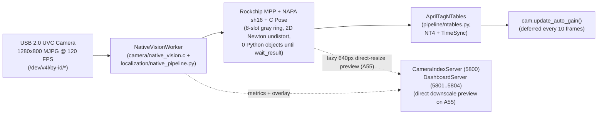

# MonkeySee Architecture

## End-to-End 120 FPS Frame Pipeline

## Module Map

| File | Responsibility |
|---|---|
| `main.py` | Sets `cv2.setNumThreads(1)`, loads `config.json`/`config_dev.json`, starts `VisionManager`, pins main thread to A55 (`0..3`), launches `DashboardServer` + `CameraIndexServer`. |
| `camera/native_vision.c` | Fused C worker (`libnative_vision.so`): V4L2 `MMAP` (`BUFFERSIZE=2`) -> `wc_pkt_nodup_copy` MPP HW MJPG decode into 8-slot page-touched gray ring -> `dlopen` `libnapa_v061_a76_neon2_pgo.so` (`sh16`, full-image scan) -> 2D Newton-Raphson Brown-Conrady undistortion + ground-plane pose (`nv_solve_apriltags`), plus optional `async_vpu` VPU-overlap thread and `nv_bench_multi_cam`. |
| `localization/native_pipeline.py` | Loads `/usr/local/lib/libnative_vision.so`, wraps `NvCamWorker` (`NativeVisionWorker`, 8-slot zero-copy NumPy ring views, GIL-releasing `wait_result`, V4L2 ctrl & lens/pose sync) and `solve_apriltags_native()`. |
| `camera/v4l2_mpp.c` | Standalone V4L2 + MPP C capture library (`libv4l2_mpp.so`) used by the Python fallback path. |
| `camera/camerareader.py` | Camera resolution (`1280×800` / `800×600`), `/dev/v4l/by-id/*` path lookup, `V4L2MppCamera` + OpenCV/MPP fallback, module-level `_IS_LINUX` & direct `_v4l2_mpp` hot-path access, opt-in `want_jpeg`, and tag-white auto-gain controller. |
| `localization/mpp_decode.py` | Loads `/usr/local/lib/libmpp_mjpeg.so` & `libv4l2_mpp.so`, manages pre-touched 4-slot `_RING_SLOTS` frame ring, and provides `MppMjpegDecoder` / `V4L2MppCamera` with `cv2.imdecode` fallback. |
| `localization/detection.py` | Loads `/usr/local/lib/libnapa_v061_a76_neon2_pgo.so` for fallback/offline tools, exposes `NativeNapaDetector` (`napa_set_lens` + `napa_detect_shadows_configured`, `_gray_ptr_cache`, slice-based corner reorder + `sub["id"].copy()`) and OpenCV ArUco fallback (`DETECT_TAGS`). |
| `localization/apriltag_solution.py` | Routes `CALCULATE_PARTIAL_SOLUTION()` through C `solve_apriltags_native()` (`3.84 us` 1-tag via ctypes, `~9.9–10.6×` faster than `37.91–101.04 us` Python/OpenCV) when `dist_coeffs.size <= 5`, with OpenCV `undistortPointsIter` fallback for higher-order models (`TAG_H_in=6.5`, valid IDs `1..32`). |
| `localization/undistort.py` | Loads/stores `cal.json` OpenCV camera matrices, distortion coefficients, monotonic `_cal_generation` counter for O(1) lens-change checks, and calibration diagnostics metadata. |
| `pipeline/visionmanager.py` | Spawns one `CameraPipeline` thread per enabled camera (`A76` cores `4..7`, `nice=-10`); uses `NativeVisionWorker` on Linux when NAPA is enabled (with automatic Python fallback), publishes NT4/auto-gain/recording, and encodes `640px`-max preview JPEGs by resizing directly into small buffers without full-res copies. |
| `pipeline/htmlserver.py` | Flask/Dash web UI: `CameraIndexServer` (`5800`, `/api/cameras`, `/video_feed/<id>`) and `DashboardServer` (`5801..5804`, tuning sliders, `/calibration`, `/api/calibration/health`). |
| `pipeline/ntables.py`, `pipeline/timesync.py` | Publishes tag poses (`AprilTagsCam<id>`), gamepiece detections (`GPDCam<id>`), and `CameraHealthNTables` diagnostics over NT4 with UDP clock synchronization. |
| `calibration/charuco_calibrator.py` | ChArUco (`11×8`, `DICT_4X4_50`) calibration + optical/blur self-diagnostics across OpenCV 4.x and 5.0+. |
| `calibration/calibrate_offline.py`, `calibration/test_charuco_diagnostics.py` | Offline PNG calibration / `--diagnose-only` CLI and camera-less synthetic verification suite (`--require-full`). |
| `util/config.py`, `util/logger.py`, `util/system_stats.py` | `ConfigCategory` JSON-backed live settings, structured timing logs, and CPU/thermal telemetry. |
| `algae_ncnn_model/`, `localization/gamepiece_solution.py`, `localization/visiony.py` | Gamepiece detection pipeline (NCNN YOLO11n model + `visionY` contour fallback). |

## Runtime Invariants & Threading Model

- **Big/Little Core Isolation:** `VisionManager` pins camera worker threads to Cortex-A76 big cores (`4..7`, `nice=-10`); `main.py` pins Flask/Dash HTTP & MJPEG preview encoding to Cortex-A55 little cores (`0..3`). `cv2.setNumThreads(1)` prevents OpenCV worker thread storms.
- **V4L2 `BUFFERSIZE=2` + Drain:** `BUFFERSIZE=1` caps `1280×800` UVC MJPG at `~68 FPS`. `BUFFERSIZE=2` with non-blocking latest-frame drain + immediate `VIDIOC_QBUF` achieves `120+ FPS` with zero extra stale-frame latency.
- **4-Slot MPP Ring (`_RING_SLOTS = 4`):** Pre-touched at init (25 ms tear-free window at 120 FPS) so hardware decode never tears a gray frame copied outside `CameraPipeline.lock` during MJPEG preview encoding.
- **Zero-Allocation Hot Path:** Compressed MJPG bytes are only copied when `want_jpeg` is true (recording or calibration sample capture). `cam.update_auto_gain()` runs every 10 frames *after* NT4 publish. Preview JPEGs encode lazily only while HTTP clients read `/video_feed/<id>`.
- **PEP3118 Warning Avoidance:** `NativeNapaDetector` reads packed C structs via explicit `_NAPA_DET_DTYPE` + `np.frombuffer` rather than `np.ctypeslib.as_array`.

## HTTP & NetworkTables Endpoints

| Port / Table | Endpoint / Topics | Purpose |
|---|---|---|
| `:5800` | `/`, `/api/cameras`, `/video_feed/<id>` | `CameraIndexServer` multi-camera hub, live FPS/latency/detection JSON, MJPEG streams |
| `:5801`–`:5804` | `/`, `/api/calibration/health`, `/calibration_feed/<id>` | Per-camera `DashboardServer` tuning UI, ChArUco calibration, optical health JSON |
| NT4 `AprilTagsCam<id>` | `tl`, `tx`, `distances`, `tags`, `curFrameNum`, `result`, `sync_rtt_ms` | Real-time AprilTag telemetry + synchronized capture timestamp |
| NT4 `AprilTagsCam<id>` | `health_ok`, `health_status`, `health_issues`, `blur_score` | `CameraHealthNTables` runtime & optical self-diagnostics |
